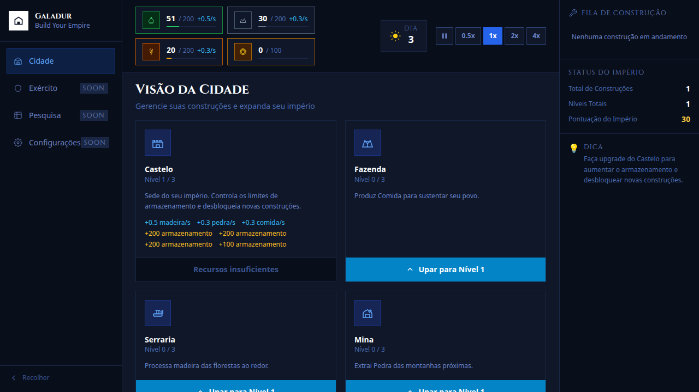
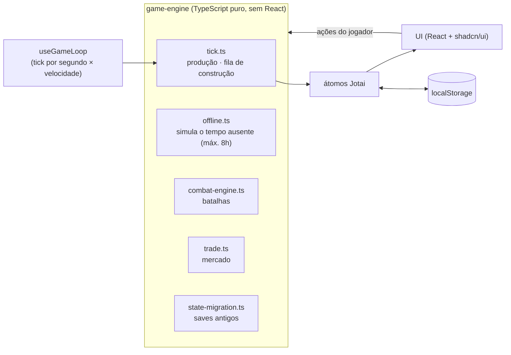

# Galadur

[](https://github.com/wenderu00/the-galadur/actions/workflows/ci.yml)
[](LICENSE)


Jogo incremental de estratégia medieval no navegador: você começa com um castelo e poucos
recursos, constrói e evolui edifícios que produzem madeira, pedra, comida e ouro, treina
um exército e expande o império, inclusive enquanto está fora (até 8 horas de
progresso offline).

**[▶ Jogar](https://wenderu00.github.io/the-galadur/)**



## Arquitetura

A regra do jogo não depende do React. Ela vive numa **engine de funções puras** em
`src/features/game-engine/`, que recebe um `GameState` e devolve o próximo:



- **Balanceamento como dados:** cada edifício, unidade e inimigo é uma definição em
  `src/config/`, então ajustar custos e produção não mexe na engine.
- **Estado global com Jotai**, persistido no `localStorage` e migrado entre versões
  do formato do save.
- **Features por pasta** (`building`, `construction`, `resource`, `army`, `empire`…), cada
  uma com componentes, hooks e tipos próprios.

## Testes

| Tipo      | Ferramenta                  | O que cobre                                                                                                     |
| --------- | --------------------------- | --------------------------------------------------------------------------------------------------------------- |
| Unitários | Vitest                      | 43 testes da engine: produção, construção, combate, comércio, progresso offline e migração de estado            |
| E2E       | Playwright com Page Objects | 13 specs: HUD de recursos, grade de construções, fluxo de upgrade, exército, velocidade do jogo e layout mobile |

O CI roda lint, `format:check` e os testes unitários a cada push.

## Rodando localmente

```bash
npm ci
npm run dev          # http://localhost:5173
npm run test:unit    # engine
npm run test:e2e     # Playwright (sobe o dev server)
```

## Evolução

O Galadur é um projeto antigo que foi reescrito conforme eu aprendia: começou em Java
(2024), passou por React com JavaScript e por uma versão em JS puro com HTML (2025) até
chegar a esta, em TypeScript, com a engine separada da interface e testada.

## Stack

React 18 · TypeScript · Vite · Jotai · Tailwind CSS · shadcn/ui · Framer Motion · Vitest · Playwright · GitHub Pages

A documentação completa de tipos, engine e componentes está em [`PROJETO.md`](PROJETO.md),
e a identidade visual em [`VISUAL_IDENTITY.md`](VISUAL_IDENTITY.md).

## Licença

[MIT](LICENSE)
